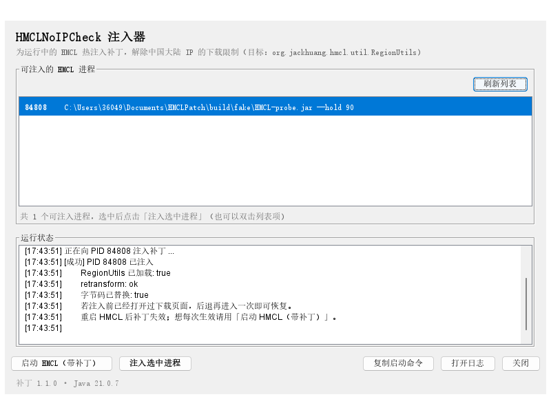

# HMCLNoIPCheck 1.1.0

HMCL 3.17 的「IP 地区校验导致无法下载游戏」热注入补丁：一个 Java Agent，在 JVM 里把
`RegionUtils#isIsChinaMainlandNetwork()` 换成永远返回 `false` 的版本。
**不改 HMCL 本体、不破坏签名与自动更新**，附带一个图形注入窗口。

已构建产物：`dist/HMCLNoIPCheck.jar`（36,935 字节，SHA-256 `4dd03c0b782e7f23dd35655d6821f5182873f8cfef9fb8395cd0f5bdb75523f8`）



## 拦截点

全仓库只有一处 IP 校验，在 `HMCL/src/main/java/org/jackhuang/hmcl/util/RegionUtils.java`：
请求 `https://ipwho.is` 判断是否中国大陆网络。返回 `true` 时两个页面被整页禁用：

| 调用点 | 后果 |
| --- | --- |
| `ui/download/VersionsPage.java:456` | 安装新游戏页插入 `download.china` 警告 + `root.setDisable(true)` |
| `ui/instances/DownloadListPage.java:631` | 资源/整合包下载页同样 `pane.setDisable(true)` |

`isIsChinaMainlandMachine()`（时区/GeoID）**不参与**封锁，只影响 BMCLAPI 镜像优先级和
Terracotta，所以补丁刻意不改它——改了反而让国内用户走官方源、下载变慢。

## 源码

```
src/
├── org/jackhuang/hmcl/util/RegionUtils.java   被替换的类：只把 isIsChinaMainlandNetwork() 改成 return false
└── hmclpatch/
    ├── NoIPCheckAgent.java                    premain / agentmain / ClassFileTransformer
    ├── InjectionWindow.java                   图形注入窗口（Swing）
    ├── Injector.java                          进程发现 + 热注入（窗口与命令行共用）
    ├── LaunchSupport.java                     定位 HMCL、拼 HMCL_JAVA_OPTS、启动
    ├── AttachSupport.java                     jdk.attach 封装（隔离，JRE 下不拖垮入口）
    ├── PatchLog.java                          写 HMCLNoIPCheck.log
    └── Main.java                              命令行入口（不带参数即开窗口）
stubs/                                         2 个被 shadowJar 精简掉的编译期类型（注解/常量）
assets/                                        README.txt 与两个 bat，构建时转 GBK 拷进 dist
dist/                                          已构建的 jar + 文档 + 启动脚本
docs/gui.png                                   窗口截图
build.ps1                                      一条命令构建
```

补丁类与 HMCL 原版**成员完全一致**（`javap -p` 比对 9 个成员，class 版本 61），所以既能
`-javaagent` 启动期注入，也能对已加载的类 `retransformClasses` 热替换；补丁字节码存在 jar 内的
`patch/org/...` 非规范路径，避免与系统类路径上的原类抢定义。

## 构建

```powershell
powershell -NoProfile -ExecutionPolicy Bypass -File build.ps1
# 没有 JDK 17+ 时指定： -Jdk "C:\Program Files\Java\jdk-21"
```

`build.ps1` 会：找 JDK 17+ → 从官方 `HMCL-3.17.0.362.exe`（= 启动器 + jar）里按 EOCD 抽出运行时 jar
到 `build/`（临时目录，可随时删）→ 编译补丁类与 agent → 校验成员一致性与 class 版本 → 打 jar
（`Premain-Class` / `Agent-Class` / `Can-Retransform-Classes`）→ 自检 jar 条目与 Manifest → 输出 SHA-256。
exe 不在默认位置时加 `-HmclExe <路径>`。

## 使用

```bat
:: 0) 图形窗口：双击 dist\start-window.bat，选进程点「注入选中进程」
:: 1) 启动期注入（长期有效）
set HMCL_JAVA_OPTS=-javaagent:"C:\path\to\HMCLNoIPCheck.jar"
HMCL-3.17.0.362.exe
:: 2) 一键启动
java -jar HMCLNoIPCheck.jar --run "C:\path\to\HMCL-3.17.0.362.exe"
:: 3) 注入已运行的 HMCL（本次有效，重启失效）
java -jar HMCLNoIPCheck.jar --attach
java -jar HMCLNoIPCheck.jar --list
```

HMCL 官方 exe 启动器（HMCLauncher）会读取 `HMCL_JAVA_OPTS` 并原样传给 java。
生效判断：jar 同目录 `HMCLNoIPCheck.log` 出现 `已替换 org.jackhuang.hmcl.util.RegionUtils`。

## 已验证

| 场景 | 结果 |
| --- | --- |
| 不打补丁，反射调用真实方法 | `true` ← 这正是下载被禁用的原因 |
| `-javaagent` 启动期注入 | `false`，日志 `已替换 …（类加载期）` |
| 直接拿官方 exe 当 jar 加载 | 打补丁前 `true` / 打补丁后 `false` |
| `--attach` / 窗口注入运行中的 JVM | `retransform: ok`、`字节码已替换: true`，探针 `true → false` |
| 端到端：`HMCL_JAVA_OPTS` + 官方 exe | 实际命令行带 `-javaagent`；HMCL 日志里 `Fetching network information`（ipwho.is 请求）**1 次 → 0 次** |

## 注意

- 需要 Java 17+（HMCL 3.17 本身的要求）；双击 jar 只有在系统默认 Java 是 17+ 时才开窗口，
  Windows 默认通常还是 Java 8，所以请用 `start-window.bat`。
- 只对类名/方法名相同的 HMCL 3.17 构建有效；HMCL 大版本改动后重新编译即可（改法不变）。
- 热注入只对当前这次运行有效；想每次生效用 `HMCL_JAVA_OPTS` 或窗口里的「启动 HMCL（带补丁）」。
- `--attach` 需要完整 JDK（`jdk.attach` 模块）且与 HMCL 同用户、同权限运行。
